# Cerebras Video Demos

<p align="center"><a href="templates/readme/hero.mp4">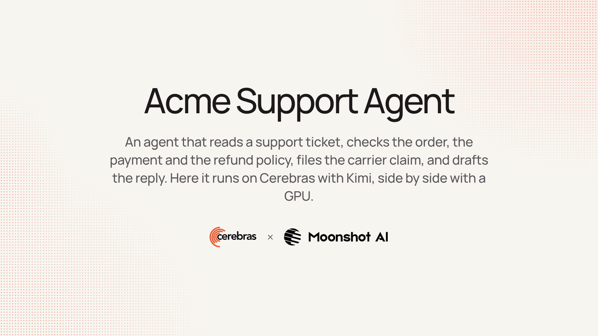</a><br><sub><b>▶ An agent on Cerebras (left) against a GPU (right), made with this repository from one small JSON file</b> (<a href="templates/readme/hero-run.json"><code>hero-run.json</code></a>). Click for the full 26 s MP4 (this is its best 12 s).</sub></p>

**This repository generates Cerebras video demos: on-brand, specialising in side-by-side comparisons and in HTML-renderable video.** A demo is a web page whose every frame is a pure function of time, built from the Cerebras house components, themes, marks and faces. It plays live as a block on a page, or is rendered to an MP4 or GIF (on your machine or on AWS), and the same input always renders the same film. Cerebras against a GPU, side by side, to the millisecond, is what it does best.

> **Hackathon?** This kit makes the 60-second demo video the Cerebras x Kimi K3.1 Pro x OpenClaw Weekend Hackathon asks for (side-by-side with a GPU, the speed claim, your project's recording). The event's requirements, timeline and a post template are in [templates/HACKATHON.md](templates/HACKATHON.md#the-event-cerebras-x-kimi-k31-pro-x-openclaw-weekend-hackathon).

> **A baseline for your creativity.** Everything here is a starting point: the scenes, the six themes and the templates are what we have drawn so far, and the repository is built to be extended. Ask your agent of choice (Claude Code, Codex, Cursor, Gemini, ...) to add the scene your product needs, a theme in your brand colours, your language; every change is held by deterministic checks. See [`templates/EXTENDING.md`](templates/EXTENDING.md) for the rules and a prompt to paste, and the **[gallery of example videos, components and themes](https://claude.ai/artifact/VytAgnVMnn7jEPmwwsY9dz)**.

## 1. Dependencies

Check these first; nothing else works without them.

| You need | For | Version | Check |
|---|---|---|---|
| **Python** | building every film (the standard library only) | 3.8+ | `python3 --version` |
| **Node.js** and `npm install` | the renderer and the checks (puppeteer, which downloads a Chrome for Testing) | 18+ | `node --version`, then `npm install` |
| **ffmpeg** and **ffprobe** | encoding the MP4, extracting a clip's frames | any recent | `ffmpeg -version` |
| *optional:* **AWS CLI** + credentials | rendering in the cloud (`--cloud`): one `bash lambda/deploy.sh` creates the function | v2 | `aws sts get-caller-identity` |

The Python, Node and ffmpeg versions in the *comparison-layout* section further down apply only to that layout; the film tools need what this table says.

Then, once:

```bash
npm install
python3 tools/make-film.py --check   # seconds: must print READY (the full gate, `bash tools/agent-film-check.sh`, is for people changing the repo)
```

## 2. Two types of video

| | **Put a video inside** | **Recreate it** |
|---|---|---|
| What it is | **your own video** (a screen recording of your agent working) becomes the whole window, rounded to the house's corners; the house styling is around it: an introduction slide, the speed claim, the lockup | the agent UI **rebuilt in HTML** from the house components and played from your words (or from a video you rebuild frame by frame): the typed task and the mouse click, the conversation, a browser pane, side-by-side Cerebras against a GPU lanes, the answer |
| You bring | a 16:9 clip and a few lines of words | your agent's run as text (the task, what it said and did, the answer) |
| You get | an MP4 in about 15 minutes | an MP4, a GIF or a **live block on a page**, deterministic and themeable |
| Start | [`templates/project-demo/storyboard.json`](templates/project-demo/storyboard.json) | [`templates/from-run/run.json`](templates/from-run/run.json) (from a run) |

<table>
<tr>
<td width="50%">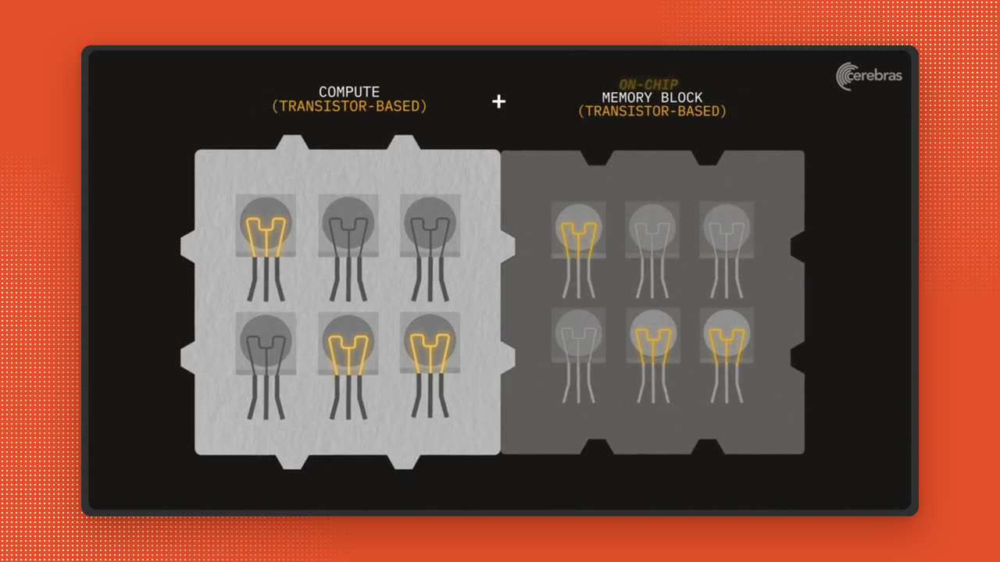<br><sub><b>Put a video inside:</b> your clip is the whole window</sub></td>
<td width="50%">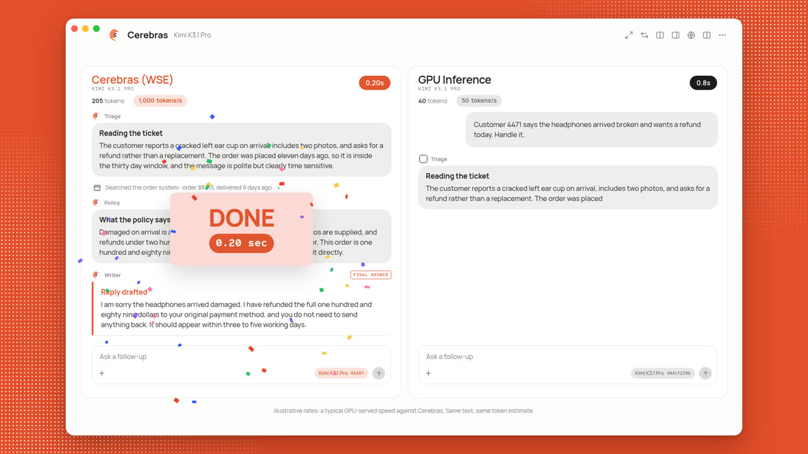<br><sub><b>Recreate it:</b> Cerebras (Kimi, up to 1,000 tokens/s) on the left is done in 0.20 s; the GPU lane is still going (exact maths, 20x)</sub></td>
</tr>
</table>

Both start with an **introduction slide** that says what the project is: a title and a description.

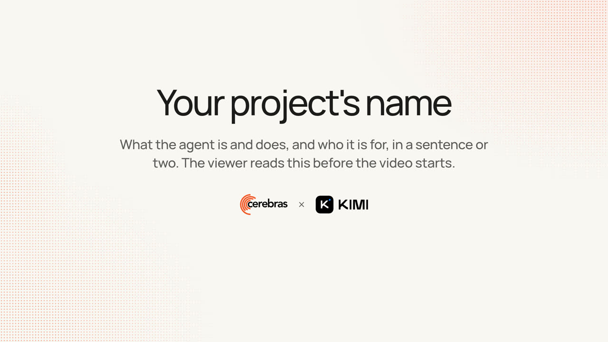

## 3. What a recreated film is made of

Every film is built from the same house components; you supply words, a theme and (optionally) a clip. Text streams word by word at Cerebras speed (never below 1,000 tokens a second, enforced; **Kimi is stated as up to 1,000**, so a Kimi film runs at exactly 1,000), boxes grow with their text, and a frame is a pure function of its time.

<table>
<tr>
<td width="33%">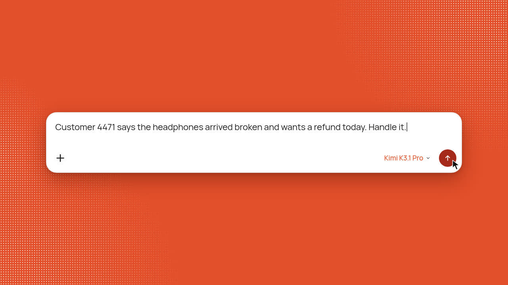<br><sub><b>The mouse and the click</b>, in every theme</sub></td>
<td width="33%">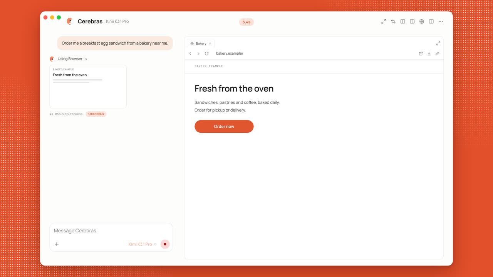<br><sub><b>A browser pane</b>: tabs, pages, scroll, a modal, a pointer click</sub></td>
<td width="33%">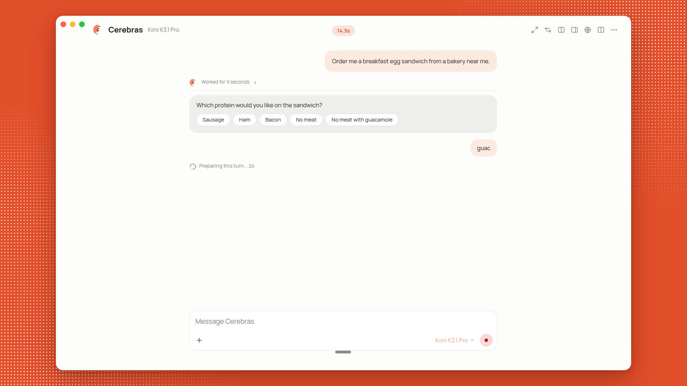<br><sub><b>An ask</b>: a question, options, the user's reply</sub></td>
</tr>
<tr>
<td width="33%"><br><sub><b>Cerebras against a GPU</b>, side by side</sub></td>
<td width="33%">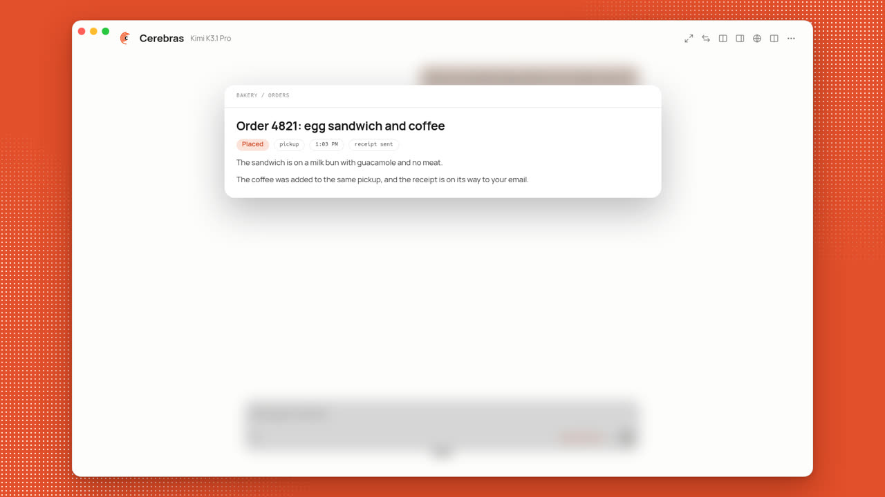<br><sub><b>An integration card</b> over a defocused window</sub></td>
<td width="33%"><br><sub><b>The click and the morph</b> into the window</sub></td>
</tr>
</table>

## 4. Make yours in three steps

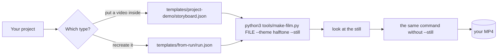

```bash
cp templates/from-run/run.json my-run.json    # or templates/project-demo/storyboard.json; edit the words
python3 tools/make-film.py my-run.json --theme paper --still     # one frame: look at it
python3 tools/make-film.py my-run.json --theme paper             # the MP4 (add --cloud to render on AWS)
```

`make-film.py` checks your input, builds the film, measures the layout in a real browser, runs about 600 deterministic checks, and only then renders. If anything is wrong it stops and says which key to fix. The full walk-through for a person is [templates/START-HERE.md](templates/START-HERE.md); an AI agent doing it for you is handed [templates/AGENT-INSTRUCTIONS.md](templates/AGENT-INSTRUCTIONS.md).

## 5. Pick a look

The same film in any of six themes: change one word (`--theme`). The default, `halftone`, is the video at the top of this page. Each other theme has a short demo of the same film above its picture; in each picture, left to right: the intro slide, the window, the claim. Colours and weights are not options on purpose: every film is on brand. The slow-ground themes take longer to render; `--cloud` picks the right number of windows for you.

**`halftone`** (default, fastest)
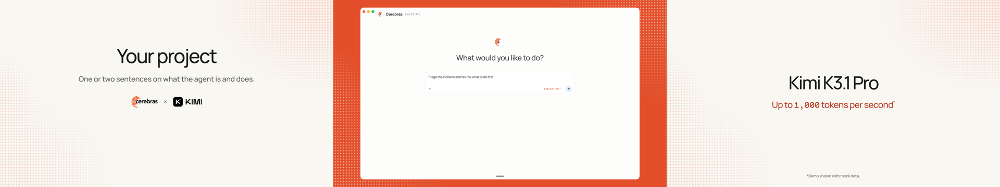

**`paper`** (light and quiet)
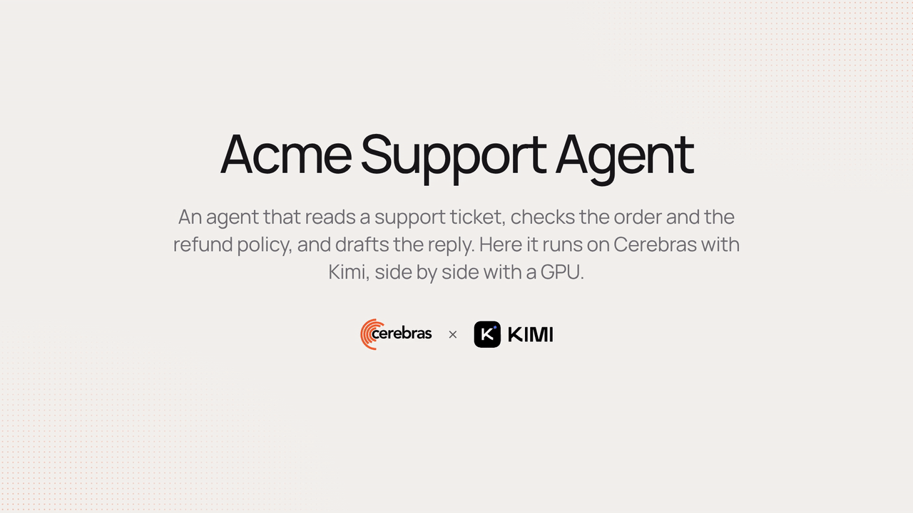

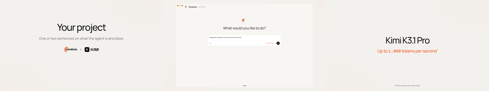

**`ember`** (dark)
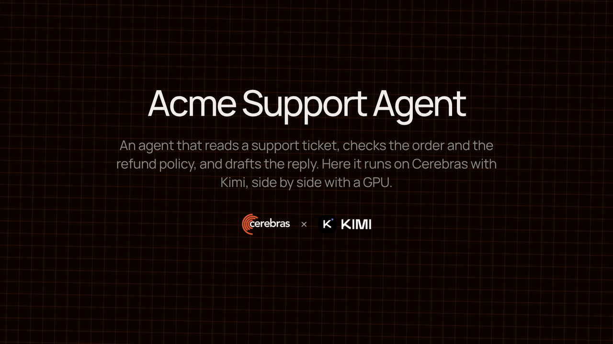

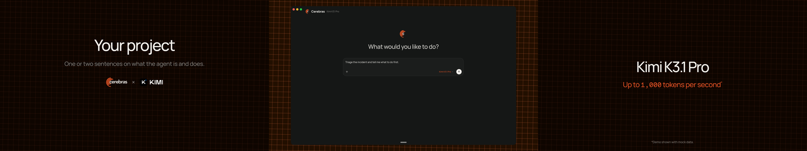

**`glow`** (warm grain; slow ground)
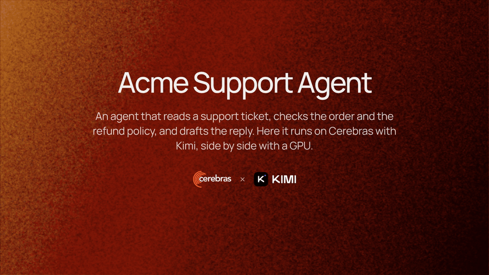

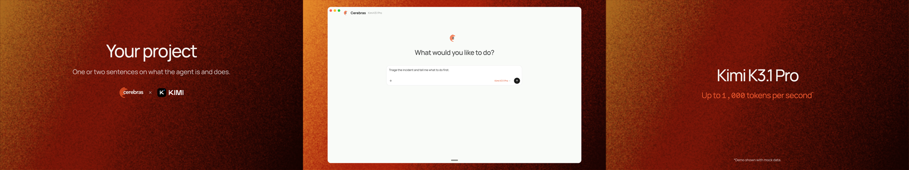

**`bloom`** (dark blob with a maroon halo; slow ground)
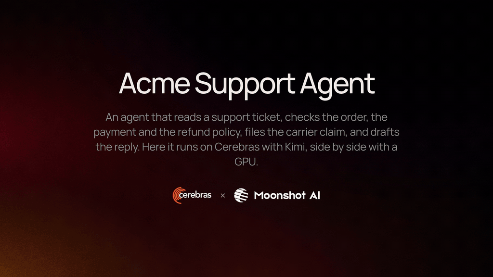

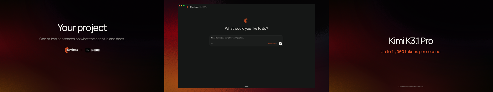

**`tile`** (gold geometric tiles; slow ground)
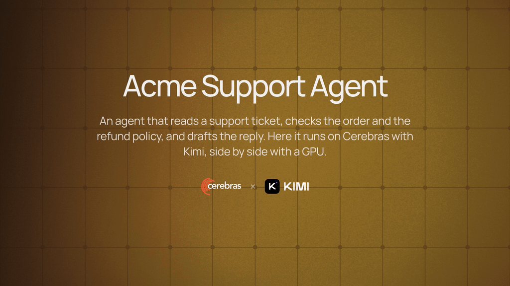

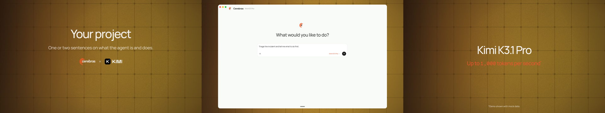

## 6. The rules in one minute

**Do:** say what the project is in a sentence or two a stranger could repeat; put the agent's real words in; give any GPU rate a note saying where it comes from; look at the still before you render; keep it short (a short run is about 25 s; 20 to 60 s is the range).
**Don't:** invent features, numbers, customers or quotes; show a real company's page or a person's private data; put the Cerebras mark on a competitor; render a film that has not passed its checks; type your own timings (they are derived).
The full list, with the render rules, is in [templates/agent-film/README.md](templates/agent-film/README.md) (the reference for every key and state).

## Where to go

| I want to... | Read |
|---|---|
| make a film, step by step | [templates/START-HERE.md](templates/START-HERE.md) |
| have my AI agent make it | [templates/AGENT-INSTRUCTIONS.md](templates/AGENT-INSTRUCTIONS.md) |
| every key, state, rule and check | [templates/agent-film/README.md](templates/agent-film/README.md) |
| the hackathon rules, post template and tracks (including rebuilding a video as live HTML) | [templates/HACKATHON.md](templates/HACKATHON.md) |
| see what it can make (example videos, components, themes) | the **[gallery](https://claude.ai/artifact/VytAgnVMnn7jEPmwwsY9dz)** |
| extend it with my agent (a new scene, theme or language) | [templates/EXTENDING.md](templates/EXTENDING.md) |

## What is in each folder

| Folder | What it is |
|---|---|
| `templates/` | everything you start from: the project-demo, from-run and pop-in templates, the five example films, the docs (`START-HERE.md`, `AGENT-INSTRUCTIONS.md`, `EXTENDING.md`, `HACKATHON.md`) and the pictures this README uses |
| `components/agent/` | the look: the six themes (`agent.css`), the grounds (`ground.js`, `bloom.js`) and the film engine that plays a storyboard at an instant (`film.js`) |
| `artifact/` | the film builder (`agent_film.py`) and the component and page builders it uses |
| `tools/` | `make-film.py` (the one command), the renderer (`agent-film.mjs`), the verifier and the gate (`agent-film-check.sh`) |
| `brand/`, `fonts/`, `kits/kimi/brand/` | the Cerebras marks, the two typefaces and the Kimi marks |
| `lambda/` | optional: render in your own AWS account (your credentials, your cost) |
