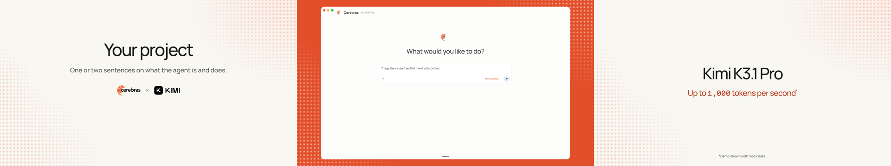
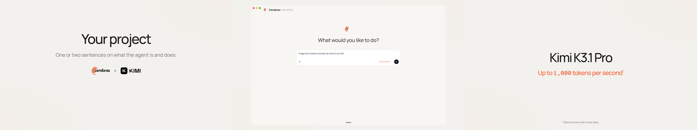
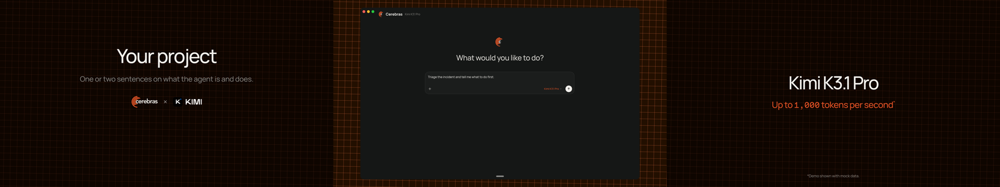
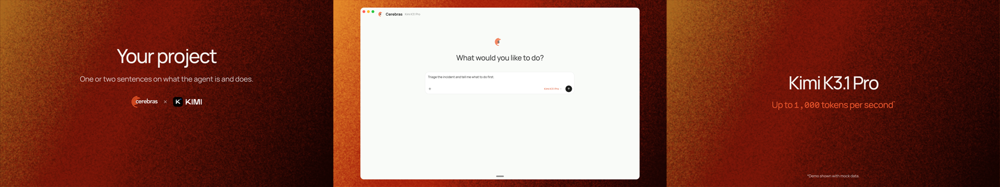
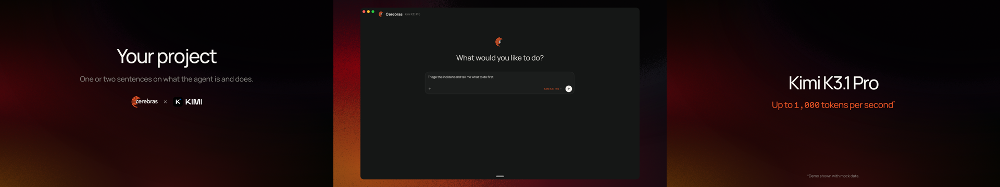
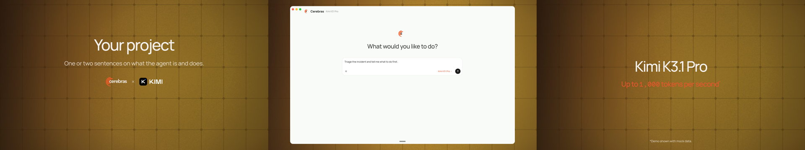

# Make a Cerebras demo film of your agent

You will end up with an **MP4** (20 to 60 seconds, 1920 x 1080) that opens with an introduction slide (a title and a description) saying what your project is, shows your agent working, and closes with the Cerebras lockup. Two paths, six looks, one command.

> **See what it can make first:** the [gallery](https://claude.ai/artifact/VytAgnVMnn7jEPmwwsY9dz) (example videos, components, themes). This kit is a baseline for your creativity: when you want something it does not do yet, ask your agent to extend it ([`EXTENDING.md`](EXTENDING.md)).
>
> Using an AI agent to do this for you? Give it [`AGENT-INSTRUCTIONS.md`](AGENT-INSTRUCTIONS.md) and your project; it knows the whole procedure. Everything below is for doing it yourself.

## 0. Check your machine (once, seconds)

You need `python3` (3.8+), `node` (18+), `ffmpeg` and `ffprobe` on your PATH. Then, in this repository:

```bash
npm install                          # fetches a browser the renderer uses
python3 tools/make-film.py --check   # must print READY; if not, it lists what is missing
```

(`bash tools/agent-film-check.sh` is the full gate for people changing the repo: minutes, not needed to make a film.)

## 1. Pick your path

| | **Path 1: Put a video inside** | **Path 2: Recreate it (HTML)** |
|---|---|---|
| You have | a screen recording of your agent working (any video; 16:9 is best) | what the agent did, as text: the task, what it said, the tools it used, the answer. No video needed |
| You get | an intro slide, then **your video as the whole window** with rounded corners, then the speed claim and the lockup | your agent's run **rebuilt as HTML** in the house components and rendered: the typed task (with the mouse click), the run as a conversation, the answer, the claim, the lockup. Optionally **your run against a GPU, side by side** |
| You edit | [`project-demo/storyboard.json`](project-demo/storyboard.json) | [`from-run/run.json`](from-run/run.json) |
| Time | about 15 minutes | about 20 minutes |

Not sure? If you have no video, take Path 2.

## 2. Pick a look (the theme)

The same film in any of six themes. **Dark:** `ember`, `bloom`. **Light:** `paper`, `glow`. **Colourful:** `halftone`, `tile`. Only the `theme` word changes; you cannot change colours or weights, on purpose, so every film looks like the house. Look at the picture (left: the intro slide, middle: the window, right: the claim), then pick:

| Theme | Look | Good for | Render note |
|---|---|---|---|
| `halftone` (default) | vermilion with a crisp halftone of small squares | anything; the house look of the reference videos | fastest |
| `paper` | warm, light, quiet | a calm, document-like demo | fast |
| `ember` | dark window on a dark grid | dev tools, terminals, night mode | fast |
| `glow` | light window on a warm orange grain | the original Cerebras ad look | slow ground |
| `bloom` | dark blob with a maroon halo and ochre glow | a dramatic, cinematic opener | slow ground |
| `tile` | gold geometric tiles | a premium, decorative look | slow ground |








"Slow ground" themes draw a textured background and take several times longer to render; use `--cloud` for them (the command picks the right number of windows for you).

## 3. Make the film

### Path 1: put a video inside

1. Put your video next to the repo (any format ffmpeg reads). No video yet? `bash templates/pop-in/make-sample-clip.sh` writes a stand-in.
2. Copy and edit the storyboard:
   ```bash
   cp templates/project-demo/storyboard.json my-film.json
   ```
   Change: `slug` (a short name, lowercase and dashes), `model` (your model's name), `popin.video` (the path to your video), `claim.footnote` (what the number is, e.g. `*Up to 1,000 tokens per second: Kimi on Cerebras.`), and in the first scene the `intro` words: `title` (your project's name) and `description` (what the agent is and does, in a sentence or two). An intro slide is a title and a description (with the Cerebras × Kimi logos under it): no bullet points (fold your features into the description). You do not type any `ms`: every scene's length is derived from its content (your clip's own length, the time the intro needs to be read).
3. Preview, then make it:
   ```bash
   python3 tools/make-film.py my-film.json --theme halftone --still      # one frame: LOOK at it
   python3 tools/make-film.py my-film.json --theme halftone              # the MP4
   ```

### Path 2: recreate it from a run

1. Copy and edit the run log:
   ```bash
   cp templates/from-run/run.json my-run.json
   ```
   Change: `project` and `description` (the intro slide: a title and a description); `model`; `prompt` (the task as the user would type it); `messages` (what the agent said, in order: `{"who": "Planner", "title": "Reading the ticket", "text": "..."}`, a tool call as `{"kind": "tool", "text": "Searched the order system"}`, and `"verdict": true` on the last message); `answer` (a one-line `lead` and a few `bullets`).
2. Preview, then make it:
   ```bash
   python3 tools/make-film.py my-run.json --theme paper --still       # photographs the money shot; add --at MS for any moment
   python3 tools/make-film.py my-run.json --theme paper
   ```
3. **GPU against Cerebras:** add `"compare": {"gpu_tps": 60, "gpu_tps_range": [30, 99], "note": "where your GPU number comes from"}` to the run log. The film shows both lanes streaming your run; the maths on screen is exact. The Cerebras lane runs at 1,000 tokens a second or more, and **Kimi is stated as up to 1,000**, so a Kimi film runs at exactly 1,000. The `note` is required: say where the GPU rate comes from, or that it is illustrative.

Both commands do everything (the film comes out about 25 s for a short run; the key-by-key guide for the run log is [`from-run/README.md`](from-run/README.md)): they check your input, build the film, **measure the layout**, run about 600 checks and only then render. Add `--cloud` to render on the AWS function (needs the keys your team gave you) instead of your own machine.

## 4. Optional extras (leave them out and nothing is drawn)

| Add this to the storyboard or run log | You get |
|---|---|
| `"attachment": {"title": "Billing export", "meta": "CSV · 41,820 rows"}` | a stack of pages slides in beside the typed prompt, and a file card rides under your message |
| `"timer": true` | an elapsed-time pill in the window's title bar |
| `"compare": {...}` (Path 2) | your run against a GPU |
| in `answer`: `"confetti": true` | a confetti burst when the answer lands |

## 5. If it stops

The command stops at the first problem and prints the reason. The common ones:

| It says | Do this |
|---|---|
| `unknown key(s) [...]` | you typed a key the film does not have; the message lists the allowed ones |
| `theme 'x' is not one of ...` | pick one of the six names above |
| `a typing scene needs at least ...` / `the intro slide needs at least ... ms` | the scene is too short for its words; make `ms` bigger (or let Path 2 derive it) |
| `the answer card ends ... px into the docked composer` | shorten the answer: fewer or shorter bullets |
| `the typed prompt is ... px tall` | shorten the `prompt` |
| `versus needs a "note"` | add where the GPU rate comes from, or that it is illustrative |
| `the Cerebras lane streams at least 1000 tokens a second` | a Cerebras speed below 1,000 is refused: raise `cerebras_tps` or leave it out |
| `popin video not found` | the path in `popin.video` is wrong |
| `STOPPED at the verify` | a check failed; the message says which. Do not render. Fix the input and run again |

## 6. What to share

The MP4 in `out/agent-film/<slug>/`, and your storyboard or run log. (A film is only your words and your clip: it holds no colours or components of its own.)
